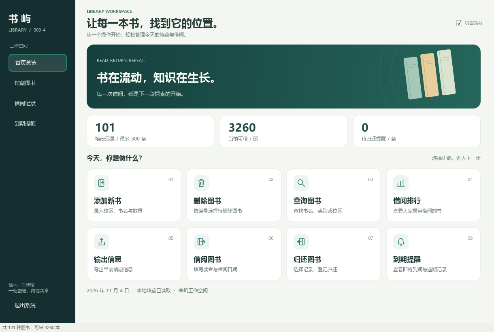

# 图书馆管理系统 · Qt 图形界面

这是给 `D:\图书馆管理系统\309-4` 的 C 控制台程序做的 Qt Widgets 图形界面，直接读写同一套数据文件，不需要启动 `library.exe`。

## 功能

- **图书管理**：显示全部图书、按书名/编号/类别搜索、按借阅次数排序、添加图书（仙林/三牌楼、价格、查重）、删除选中图书。
- **借阅管理**：借阅图书（选择书名、学号、姓名、数量、借书日期，自动算 30 天后的应还日期）、归还选中记录（支持部分归还）、查看全部借阅记录。
- **到期提醒**：列出 7 天内到期或已经逾期的未归还记录，显示剩余/逾期天数。

## 数据文件

程序默认读写：

```
D:\图书馆管理系统\309-4\
├─ book.txt      图书（7 字段）
├─ borrow.txt    借阅记录（旧版 9 字段，新版增加图书编号）
└─ remind.txt    提醒（原 C 程序使用，GUI 自己按日期计算）
```

`book.txt` 每行：

```
编号 书名 类别 价格 总数 可借 借阅次数
XL-B001 红楼梦 文学 49.80 100 80 1
```

`borrow.txt` 每行：

```
借阅编号 书名 学号 姓名 借书日期 应还日期 未还数量 天数 状态 图书编号
L000001 红楼梦 B25012225 周玉影 2026-11-29 2026-12-06 25 20 未归还 XL-B001
```

如果数据目录换了位置，可以设置环境变量 `LIBRARY_DATA_DIR`，或修改 `mainwindow.cpp` 构造函数里的默认路径。

## 用 Qt Creator 打开

1. 打开 `D:\QT\Tools\QtCreator\bin\qtcreator.exe`。
2. `文件 → 打开文件或项目…`，选择 `D:\QtProjects\LibraryGui\CMakeLists.txt`。
3. Kit 选 `Desktop Qt 6.12.0 MinGW 64-bit`。
4. `Ctrl+B` 编译，`Ctrl+R` 运行。

如果 Qt Creator 提示 Qt version invalid，到 `编辑 → Preferences → Kits → Qt Versions`，把 qmake 指向：

```
D:\QT\6.12.0\mingw_64\bin\qmake.exe
```

## 命令行构建

```bat
set PATH=D:\QT\6.12.0\mingw_64\bin;D:\QT\Tools\mingw1310_64\bin;D:\QT\Tools\CMake_64\bin;D:\QT\Tools\Ninja;%PATH%

cmake -S D:\QtProjects\LibraryGui -B D:\QtProjects\LibraryGui\build ^
  -G Ninja ^
  -DCMAKE_MAKE_PROGRAM=D:/QT/Tools/Ninja/ninja.exe ^
  -DCMAKE_PREFIX_PATH=D:/QT/6.12.0/mingw_64 ^
  -DCMAKE_CXX_COMPILER=D:/QT/Tools/mingw1310_64/bin/g++.exe ^
  -DCMAKE_BUILD_TYPE=Release

cmake --build D:\QtProjects\LibraryGui\build
```

生成的可执行文件：

```
D:\QtProjects\LibraryGui\build\LibraryGui.exe
```

## 直接运行（已打包 Qt DLL）

```
D:\QtProjects\LibraryGui\dist\LibraryGui.exe
```

`dist` 目录已经用 `windeployqt` 复制了 Qt 运行库，双击即可运行。

## 测试数据

`testdata` 是 `309-4` 数据的一份副本。想在不改原数据的情况下试功能：

```bat
set LIBRARY_DATA_DIR=D:\QtProjects\LibraryGui\testdata
D:\QtProjects\LibraryGui\dist\LibraryGui.exe
```

## 注意

- 使用前备份 `book.txt`、`borrow.txt`，GUI 会整表重写 `book.txt`。
- 不要同时运行 `library.exe` 和 GUI 操作同一批文件，避免互相覆盖。
- 书名、类别、学号、姓名不能包含空格（C 端使用空格分隔字段）。
- 借阅记录里的“数量”是**还没归还的数量**，归还一部分会减少，减到 0 时状态变为“已归还”。

旧版借阅记录没有图书编号时，只有书名能唯一对应一本图书才可归还；同名记录需要先核实归属。新版记录不要交给未更新的旧版程序覆盖保存，否则可能丢失图书编号。

## 按负责人分类的修改说明

本项目与 C 控制台的修改情境、处理方法及当前边界，统一记录在工作区 [README.md](../README.md)，分为陈琪、周玉影、张锐三个部分。每次修改源码后必须同步更新对应部分。

## 新版分层界面（2026-11-04）

运行 [run_ui_preview.bat](run_ui_preview.bat)，打开独立新版程序 `dist/LibraryGui-UI.exe`。首页按主菜单提供 8 个功能入口，添加、借阅、归还和输出使用第二层页面，带卡片悬停与页面淡入效果。

详细流程、代码位置和验证结果见 [UI 修改说明](docs/UI-修改说明.md)。


